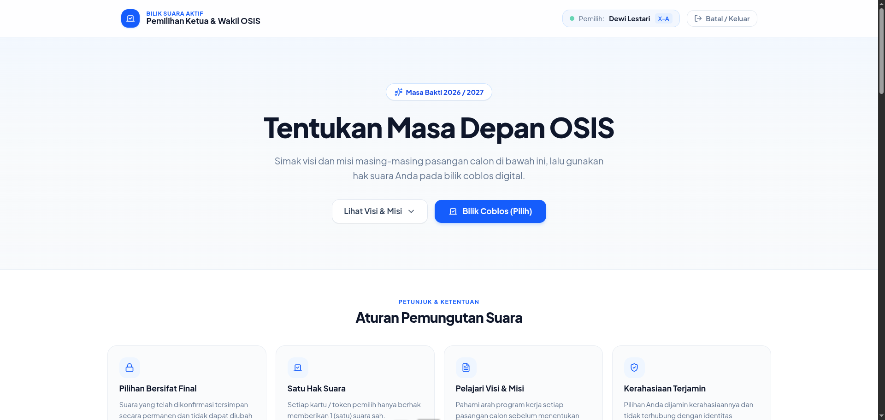

# E-Voting OSIS

Aplikasi web pemilihan Ketua & Wakil Ketua OSIS berbasis Laravel dan React (Inertia.js). Dirancang untuk bilik suara mandiri (scan QR / token manual) dengan rekapitulasi suara real-time serta sistem pemungutan suara yang menjamin kerahasiaan pilihan.

## 🛠️ Tech Stack

- **Backend**: Laravel 11, MySQL
- **Frontend**: React 19, Inertia.js, Tailwind CSS v4, Lucide React
- **Fitur/Library**: `html5-qrcode` (webcam scanner), `recharts` (grafik suara), `maatwebsite/excel` (impor/ekspor DPT & hasil)

---

## ✨ Fitur Utama

- **Bilik Suara (Siswa)**:
    - Otentikasi ganda: scan QR Code kartu pelajar (NIS) via webcam atau input token manual 6 karakter.
    - Tampilan paslon dengan nomor urut, visi & misi, serta modal konfirmasi coblos.
    - Halaman sukses dengan auto-redirect kembali ke standby setelah memilih.
    - Keamanan bilik suara: sesi pemilih terhapus setelah memilih dan proteksi cache browser (anti-back).
- **Panel Admin**:
    - Dashboard statistik kehadiran & grafik perolehan suara paslon secara real-time.
    - Kelola data paslon (CRUD data & upload foto).
    - Kelola DPT (impor/ekspor Excel, pencarian, filter kelas/status, dan reset hak suara darurat).
    - Ekspor berita acara / rekapitulasi hasil pemilu ke file Excel.

---

## 📸 Tangkapan Layar

### Bilik Suara (Pemilih)

#### 1. Standby (Scan QR / Input Token Manual)


#### 2. Informasi Pemilih & Aturan Pemilihan


#### 3. Daftar Paslon & Pemilihan (Coblos)


#### 4. Konfirmasi Berhasil Memilih


### Panel Administrator

#### 1. Login Administrator


#### 2. Dashboard & Quick Count Real-Time


#### 3. Manajemen Pasangan Calon


#### 4. Manajemen Daftar Pemilih Tetap (DPT)


---

## 🚀 Panduan Instalasi

1. **Clone repository & install dependencies**:

    ```bash
    git clone https://github.com/username/voting-osis.git
    cd voting-osis
    composer install
    npm install
    ```

2. **Konfigurasi Environment**:

    ```bash
    cp .env.example .env
    php artisan key:generate
    php artisan storage:link
    ```

    _Sesuaikan pengaturan koneksi database pada file `.env`._

3. **Migrasi database & data awal**:

    ```bash
    php artisan migrate:fresh --seed
    ```

4. **Jalankan aplikasi**:

    ```bash
    # Terminal 1 (Frontend Vite)
    npm run dev

    # Terminal 2 (Backend Laravel)
    php artisan serve
    ```

    - Bilik Suara: [http://127.0.0.1:8000](http://127.0.0.1:8000)
    - Panel Admin: [http://127.0.0.1:8000/admin/login](http://127.0.0.1:8000/admin/login)

---

## 🔑 Akun Default (Seeder)

### Administrator

- **URL**: `/admin/login`
- **Username**: `admin`
- **Password**: `admin123`

### Contoh Data Pemilih (DPT)

|  NIS   |  Token   | Nama                | Kelas      |
| :----: | :------: | :------------------ | :--------- |
| `1001` | `JHV99V` | Ahmad Rizky         | XII MIPA 1 |
| `1002` | `NLTXEN` | Siti Aisyah         | XII MIPA 2 |
| `1003` | `MKVCUW` | Muhammad Fajar      | XI IPS 1   |
| `1004` | `U3FPVN` | Dewi Lestari        | X-A        |
| `1005` | `9GLK9S` | Budi Santoso, S.Pd. | Dewan Guru |

---

## 📄 Lisensi

[MIT](LICENSE)
