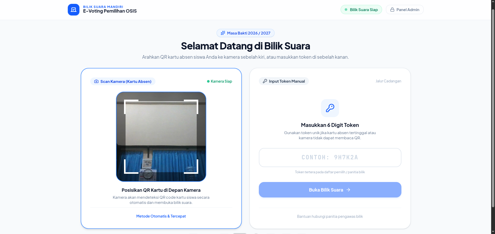
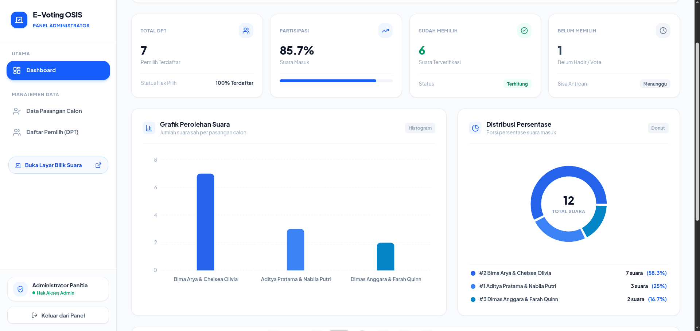

# 🗳️ E-Voting OSIS

[](https://laravel.com)
[](https://react.dev)
[](https://inertiajs.com)
[](https://tailwindcss.com)
[](https://mysql.com)

**E-Voting OSIS** adalah aplikasi pemilihan umum berbasis web modern, cepat, dan aman yang dirancang khusus untuk pemilihan Ketua & Wakil Ketua OSIS di lingkungan sekolah. Sistem ini menjamin prinsip **Luber Jurdil** (Langsung, Umum, Bebas, Rahasia, Jujur, dan Adil) dengan proses autentikasi pemilih ganda yang fleksibel serta rekapitulasi suara real-time.

---

## 🎯 Target Pengguna
- **Siswa & Guru (DPT Pemilih)**: Menggunakan bilik suara interaktif melalui scan QR Code kartu pelajar atau input manual token unik 6 digit.
- **Panitia / Pengurus OSIS & MPK (Admin)**: Mengelola Daftar Pemilih Tetap (DPT), data pasangan calon (paslon), monitoring perolehan suara real-time, serta export rekap hasil ke Excel/PDF.

---

## ✨ Fitur Utama

### 1. 🗳️ Bilik Suara Mandiri (Voting Booth)
- **Dual-Bar Standby Authentication**:
  - **Bar Kiri**: Pemindai kamera langsung (*live webcam scanner*) untuk scan QR Code Kartu Pelajar (NIS). Otomatis login tanpa perlu klik tombol.
  - **Bar Kanan**: Input manual Token unik 6 karakter (fallback jika kartu pelajar rusak/hilang).
- **Auto-Reset Security Timer**: Reset otomatis kembali ke halaman standby dalam 4 detik jika terjadi kesalahan scan/sudah pernah memilih agar pesan error terbaca jelas.
- **Animasi Animate On Scroll (AOS)**: Tampilan visual kartu paslon, tata tertib pemilihan, dan surat suara yang mulus dan interaktif.
- **Konfirmasi Surat Suara**: Modal verifikasi pemilihan untuk mencegah salah klik.
- **Halaman Sukses & Auto-Redirect**: Countdown 4 detik yang mengalihkan kembali ke bilik standby untuk pemilih berikutnya.

### 2. 🛡️ Prinsip Kerahasiaan (Luber Jurdil)
- Pemilihan diproses menggunakan **Database Transaction (`DB::transaction`)**:
  1. Status pemilih diubah menjadi `status_voted = true` dan dicatat waktu memilihnya (`voted_at`).
  2. Perolehan suara kandidat (`candidates.vote_count`) bertambah secara atomik.
  3. **Identitas pemilih sama sekali tidak ditautkan ke paslon yang dipilih**, menjaga kerahasiaan suara 100%.

### 3. 📊 Panel Administrasi & Quick Count
- **Portal Terpisah**: Login admin terisolasi di `/admin/login` dengan enkripsi password BCrypt.
- **Real-Time Analytics**: Visualisasi grafik persentase suara paslon dan statistik partisipasi kehadiran per kelas/jurusan.
- **Manajemen Paslon (CRUD)**: Pengaturan nomor urut paslon (`#01`, `#02`, dst), nama calon, visi, misi, dan upload foto paslon.
- **Manajemen DPT (Voters)**:
  - Import massal data siswa dari file Excel (`.xlsx`, `.csv`) dengan generate token otomatis.
  - Export DPT & kartu token ke Excel.
  - Fitur pencarian instan dan filter status (Belum Memilih / Sudah Memilih).
  - Fitur darurat *Reset Status* per pemilih jika terjadi kendala teknis di bilik suara.
- **Export Laporan Resmi**: Download berita acara hasil pemungutan suara dalam format spreadsheet.

---

## 🛠️ Tech Stack

### Backend
- **Framework**: [Laravel 11.x](https://laravel.com) (PHP >= 8.2)
- **Database**: MySQL / MariaDB
- **Excel Handling**: [Maatwebsite Excel (Laravel Excel)](https://laravel-excel.com)
- **Architecture**: Single Page Application via [Inertia.js](https://inertiajs.com)

### Frontend
- **Framework**: [React 19](https://react.dev)
- **Styling**: [Tailwind CSS v4](https://tailwindcss.com)
- **QR Code Engine**: [html5-qrcode](https://github.com/mebjas/html5-qrcode)
- **Icons**: [Lucide React](https://lucide.dev)
- **Animations**: [AOS (Animate On Scroll)](https://michalsnik.github.io/aos/) & CSS Keyframes
- **Build Tool**: [Vite](https://vitejs.dev)

---

## 📋 Prasyarat Sistem (Prerequisites)

Pastikan sistem Anda telah terpasang:
- **PHP** >= 8.2 (dengan ekstensi `pdo_mysql`, `gd`, `zip`, `mbstring`)
- **Composer** >= 2.x
- **Node.js** >= 18.x & **NPM**
- **MySQL / MariaDB** >= 8.0
- **Webcam / Kamera** (opsional, untuk pengujian fitur scan QR code)

---

## 🚀 Panduan Instalasi & Menjalankan

Ikuti langkah-langkah berikut secara berurutan:

### 1. Clone Repository
```bash
git clone https://github.com/username/voting-osis.git
cd voting-osis
```

### 2. Install Dependensi Backend & Frontend
```bash
# Install package PHP
composer install

# Install package JavaScript
npm install
```

### 3. Konfigurasi Environment (`.env`)
Salin file `.env.example` menjadi `.env`:
```bash
cp .env.example .env
```

Buka file `.env` dan sesuaikan konfigurasi database Anda:
```env
DB_CONNECTION=mysql
DB_HOST=127.0.0.1
DB_PORT=3306
DB_DATABASE=voting_osis
DB_USERNAME=root
DB_PASSWORD=
```

### 4. Generate Application Key & Symlink Storage
```bash
php artisan key:generate
php artisan storage:link
```

### 5. Migrasi Database & Seeder Data Awal
Jalankan migrasi database beserta data dummy (Admin, Paslon, & DPT Pemilih):
```bash
php artisan migrate:fresh --seed
```

### 6. Jalankan Server Aplikasi
Jalankan Vite (frontend) dan Artisan Serve (backend). Anda bisa membukanya di dua terminal terpisah:

**Terminal 1 (Vite Development Server):**
```bash
npm run dev
```

**Terminal 2 (Laravel Server):**
```bash
php artisan serve
```

Aplikasi kini dapat diakses di browser melalui URL:
- **Bilik Suara (Siswa)**: [http://127.0.0.1:8000](http://127.0.0.1:8000)
- **Portal Admin**: [http://127.0.0.1:8000/admin/login](http://127.0.0.1:8000/admin/login)

---

## 🔑 Kredensial Pengujian (Default Seeded Accounts)

### 👨‍💼 Akun Administrator
- **URL**: `http://127.0.0.1:8000/admin/login`
- **Username**: `admin`
- **Password**: `admin123`

### 🧑‍🎓 Contoh Token & NIS Pemilih (Bilik Suara)
| NIS | Token | Nama Siswa | Kelas / Jurusan | Status |
|:---:|:---:|:---|:---|:---:|
| `1001` | `JHV99V` | Ahmad Rizky | XII MIPA 1 | Belum Memilih |
| `1002` | `NLTXEN` | Siti Aisyah | XII MIPA 2 | Belum Memilih |
| `1003` | `MKVCUW` | Muhammad Fajar | XI IPS 1 | Belum Memilih |
| `1004` | `U3FPVN` | Dewi Lestari | X-A | Belum Memilih |
| `1005` | `9GLK9S` | Budi Santoso, S.Pd. | Dewan Guru | Belum Memilih |

*(Gunakan NIS di atas untuk dibuatkan QR Code barcode generator online atau langsung ketik 6 digit Token di form kanan).*

---

## 📸 Tampilan Antarmuka (Screenshots)

### 1. Bilik Suara Standby (Dual-Bar: QR Scanner & Token Input)


### 2. Daftar Pasangan Calon & Visi Misi (AOS Animation)


### 3. Modal Konfirmasi Pemilihan (Surat Suara Digital)


### 4. Dashboard Admin Real-Time & Rekapitulasi


---

## 📁 Struktur Direktori Utama

```plaintext
E-Voting/
├── app/
│   ├── Exports/            # Export data DPT & hasil pemilu ke Excel
│   ├── Http/Controllers/  # Controller Bilik Suara, Kandidat, & Admin
│   ├── Imports/            # Import massal DPT dari file Excel
│   └── Models/             # Model Eloquent (User, Candidate, Voter)
├── database/
│   ├── migrations/         # Skema tabel database
│   └── seeders/            # Seeder data paslon, voter, & admin
├── resources/
│   ├── css/app.css         # Styling Tailwind v4 & typography
│   └── js/
│       ├── Layouts/        # Layout Admin
│       └── Pages/          # Halaman React (Booth/Login, CandidateList, VoteSuccess, Admin/*)
├── routes/web.php          # Routing aplikasi
└── screenshots/            # Tangkapan layar dokumentasi
```

---

## 📄 Lisensi
Didistribusikan di bawah Lisensi [MIT](LICENSE). Silakan gunakan dan kembangkan untuk kebutuhan pemilihan umum di instansi sekolah Anda.
